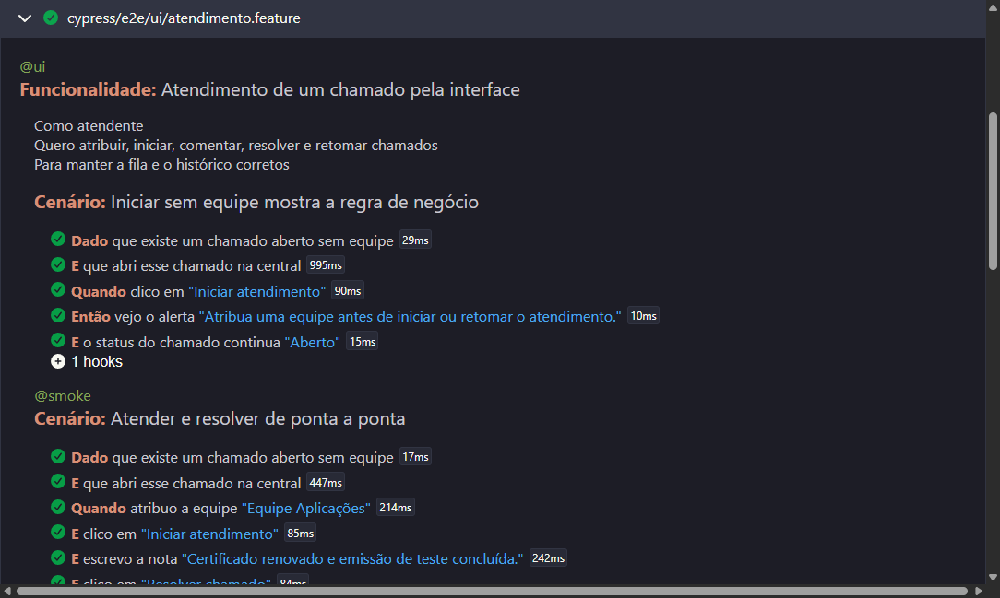

# ServiceDesk QA · Cypress + BDD + API

[](https://github.com/JVCSampaio/service-desk-qa/actions/workflows/qa.yml)
· [Relatório da última execução](https://jvcsampaio.github.io/service-desk-qa/)
· [Portfólio](https://github.com/JVCSampaio)

Suíte de testes automatizados do [ServiceDesk](https://github.com/JVCSampaio/service-desk),
uma central de chamados em React + FastAPI. Os cenários são escritos em **Gherkin, em português**,
executados pelo **Cypress** contra a aplicação real e validam as respostas da API por **contrato
(JSON Schema)**.

- **59 cenários no gate do CI** (41 de API e 18 de interface), executados em menos de 1 minuto.
- **6 defeitos reais encontrados** no ServiceDesk e levados até o fim: cenário que reproduz,
  issue com evidência, correção no [PR #7](https://github.com/JVCSampaio/service-desk/pull/7) e cenário promovido a teste de regressão
  ([BUGS.md](docs/BUGS.md)).
- **Plano de testes** com riscos, rastreabilidade de requisitos e sessão exploratória
  ([PLANO_DE_TESTES.md](docs/PLANO_DE_TESTES.md)).

<a href="https://jvcsampaio.github.io/service-desk-qa/">
  
</a>

## O que é testado

| Tipo de teste             | Arquivo                                                                    | Exemplos                                                                                             |
| ------------------------- | -------------------------------------------------------------------------- | ---------------------------------------------------------------------------------------------------- |
| Contrato de API           | [`api/contrato.feature`](cypress/e2e/api/contrato.feature)                 | Todas as respostas validadas por [JSON Schema](cypress/contratos) estrito, inclusive erros 404 e 422 |
| Validação e valor-limite  | [`api/validacao.feature`](cypress/e2e/api/validacao.feature)               | 4, 5, 120 e 121 caracteres no título; campos extras recusados (mass assignment)                      |
| Regras de negócio         | [`api/regras.feature`](cypress/e2e/api/regras.feature)                     | Prazo por prioridade, transições inválidas, versão desatualizada (409), CSV sem fórmulas             |
| Aceitação na interface    | [`ui/atendimento.feature`](cypress/e2e/ui/atendimento.feature)             | Atribuir, iniciar, resolver e retomar; edição simultânea por dois atendentes                         |
| Fila                      | [`ui/fila.feature`](cypress/e2e/ui/fila.feature)                           | Busca, filtro combinado, páginas de 8 itens, `%` tratado como texto                                  |
| Erros, segurança e layout | [`ui/resiliencia.feature`](cypress/e2e/ui/resiliencia.feature)             | Erro 500 e queda de rede simulados com `cy.intercept`, HTML no título, tela de 390 px                |
| Exploratório              | [`docs/PLANO_DE_TESTES.md`](docs/PLANO_DE_TESTES.md#8-sessão-exploratória) | Missão, heurísticas, defeitos e observações                                                          |

## Exemplo

```gherkin
@regressao
Cenário: Edição simultânea não sobrescreve o trabalho de outro atendente
  Dado que existe um chamado aberto sem equipe
  E que abri esse chamado na central
  Quando outro atendente muda a prioridade do chamado para "urgent" pela API
  E atribuo a equipe "Equipe Dados"
  Então vejo o alerta "Este chamado foi alterado. Recarregue antes de salvar novamente."
  E o detalhe é recarregado com a prioridade "Urgente"
```

O cenário prepara os dados pela API, simula um segundo atendente com uma requisição paralela
e verifica na tela que o controle de versão impediu a sobrescrita.

## Defeitos encontrados

| ID                            | Defeito                                                                                  | Severidade | Issue                                                     |
| ----------------------------- | ---------------------------------------------------------------------------------------- | ---------- | --------------------------------------------------------- |
| [BUG-01](docs/BUGS.md#bug-01) | Busca acima de 120 caracteres mostra erro genérico e fila desatualizada                  | Baixa      | [#1](https://github.com/JVCSampaio/service-desk/issues/1) |
| [BUG-02](docs/BUGS.md#bug-02) | Alerta de erro continua na tela depois que a consulta seguinte dá certo                  | Média      | [#2](https://github.com/JVCSampaio/service-desk/issues/2) |
| [BUG-03](docs/BUGS.md#bug-03) | Título com espaços passa no formulário, é recusado pela API e o aviso não indica o campo | Baixa      | [#3](https://github.com/JVCSampaio/service-desk/issues/3) |
| [BUG-04](docs/BUGS.md#bug-04) | Histórico mostra códigos internos (`open → in_progress`)                                 | Baixa      | [#4](https://github.com/JVCSampaio/service-desk/issues/4) |
| [BUG-05](docs/BUGS.md#bug-05) | Salvar sem alterações cria versão nova e provoca conflito falso para outro atendente     | Média      | [#5](https://github.com/JVCSampaio/service-desk/issues/5) |
| [BUG-06](docs/BUGS.md#bug-06) | Falha de rede aparece como "Failed to fetch" e a fila diz que não há chamados            | Baixa      | [#6](https://github.com/JVCSampaio/service-desk/issues/6) |

Todos foram corrigidos no [PR #7](https://github.com/JVCSampaio/service-desk/pull/7) do ServiceDesk, com testes próprios lá (Pytest
e Playwright). Aqui, cada cenário seguiu o mesmo ciclo: enquanto o defeito existia, ficava com a
tag `@bug`, fora do gate do CI, falhando de propósito (`npm run test:bugs`); depois da correção,
virou `@regressao` e entrou no gate. Hoje não há defeitos conhecidos em aberto.

## Executar

Requisitos: **Node.js 24**, **Python 3.14**, **Git** e **Google Chrome**.

```bash
npm ci
npm run sut:prepare
npm test
```

`sut:prepare` clona o ServiceDesk na versão fixada em `.sut/`, instala as dependências e compila
a interface. `npm test` inicia a aplicação com banco novo, roda os cenários e encerra o servidor.

| Comando                                 | O que faz                                                  |
| --------------------------------------- | ---------------------------------------------------------- |
| `npm test`                              | Todos os cenários, exceto defeitos conhecidos (`not @bug`) |
| `npm run test:smoke`                    | Caminho crítico (`@smoke`)                                 |
| `npm run test:api`                      | Só a API (`@api`)                                          |
| `npm run test:bugs`                     | Reproduz defeitos conhecidos em aberto (hoje não há)       |
| `npm run sut:start` + `npm run cy:open` | Modo interativo do Cypress                                 |
| `npm run lint`                          | Prettier e verificação de tipos do TypeScript              |

Para testar outra versão do ServiceDesk, use `SUT_REF=<commit ou branch>` no `sut:prepare`
ou `SUT_DIR=<pasta>` para apontar para uma cópia local.

O relatório Cucumber em HTML fica em `reports/cucumber-report.html`; capturas de falha, em
`cypress/screenshots/`.

## Decisões

- **Dados pela API, verificação pela tela.** Os passos `Dado` criam o cenário com requisições
  diretas (mais rápidas e estáveis); a interface só é usada no comportamento sob teste.
- **Cenários independentes.** Cada um recebe uma marca única, como `QA-MH4K2Z1F`, usada nos
  títulos e nas buscas. Nenhum depende dos dados de demonstração ou da ordem de execução.
- **Seletores acessíveis.** Os elementos são encontrados por papel e rótulo
  ([Testing Library](https://testing-library.com/docs/cypress-testing-library/intro/)), como um
  usuário ou leitor de tela os encontraria.
- **Sem esperas fixas.** A sincronização usa as asserções do Cypress e `cy.wait` em requisições
  interceptadas, nunca `cy.wait(ms)`. Asserções negativas só rodam depois da resposta chegar.
- **Sem novas tentativas.** `retries: 0`: um teste instável é tratado como defeito do teste.
- **Contratos estritos.** Os schemas recusam campos não previstos: mudança na API exige revisão
  consciente do contrato.

## CI

O [workflow](.github/workflows/qa.yml) roda em push, pull request, todos os dias às 06:00
(horário de Brasília) e manualmente, com expressão de tags e versão do ServiceDesk escolhidas
no disparo. Push e pull request testam a versão fixada do ServiceDesk; a execução diária testa a
`main` mais recente, para pegar regressões introduzidas lá. Etapas: formatação e tipos, preparação do sistema sob teste, cenários no Chrome,
relatório e capturas como artefato e publicação do relatório no GitHub Pages.

## Estrutura

```text
cypress/
  e2e/api/            cenários de API (.feature)
  e2e/ui/             cenários de interface (.feature)
  contratos/          JSON Schemas das respostas
  support/
    step_definitions/ passos em TypeScript
    comandos.ts       preparação de dados pela API
    contrato.ts       validação com Ajv
docs/                 plano de testes, defeitos e evidências
scripts/sut.mjs       prepara e inicia o ServiceDesk
```

## Limites

Não há testes de carga, auditoria completa de acessibilidade nem execução em outros navegadores
além do Chrome. O ServiceDesk não tem autenticação, então não há cenários de permissão.
Persistência após reinício é coberta pelos testes Pytest do próprio ServiceDesk.

Licença [MIT](LICENSE).
