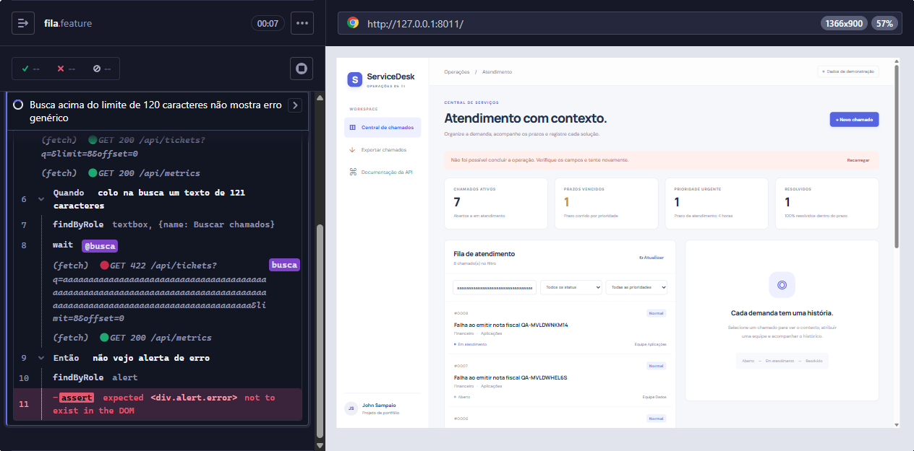
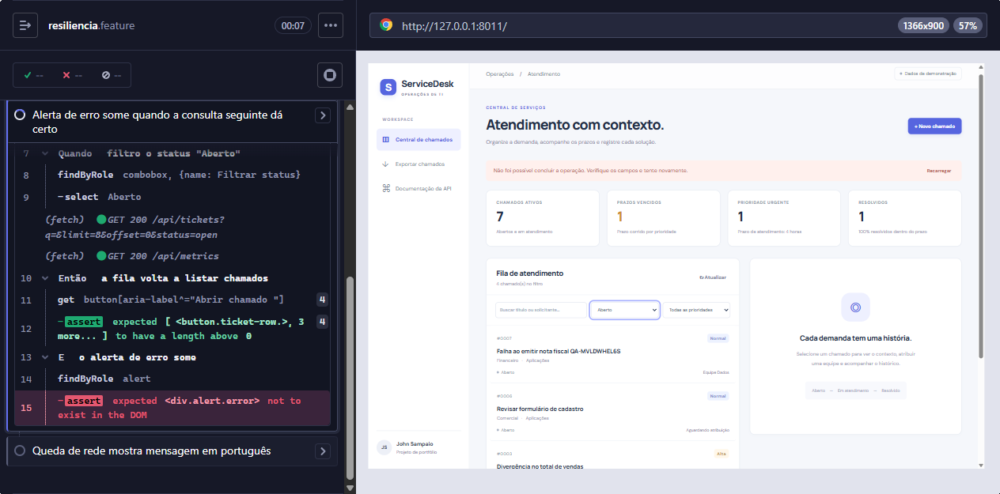
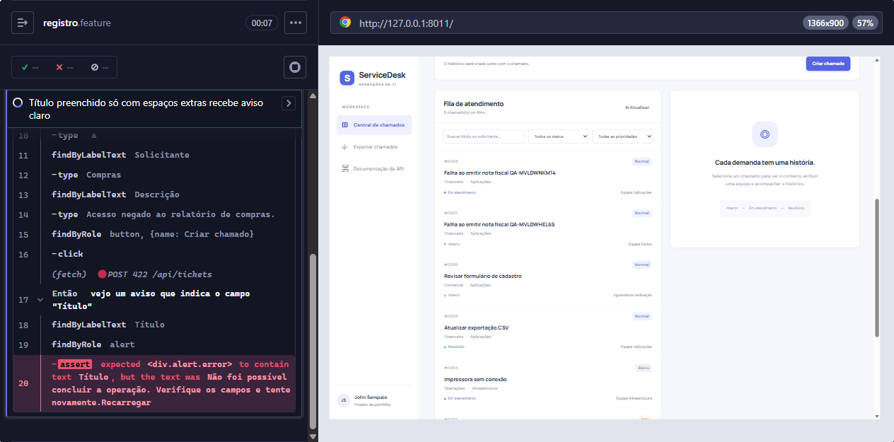
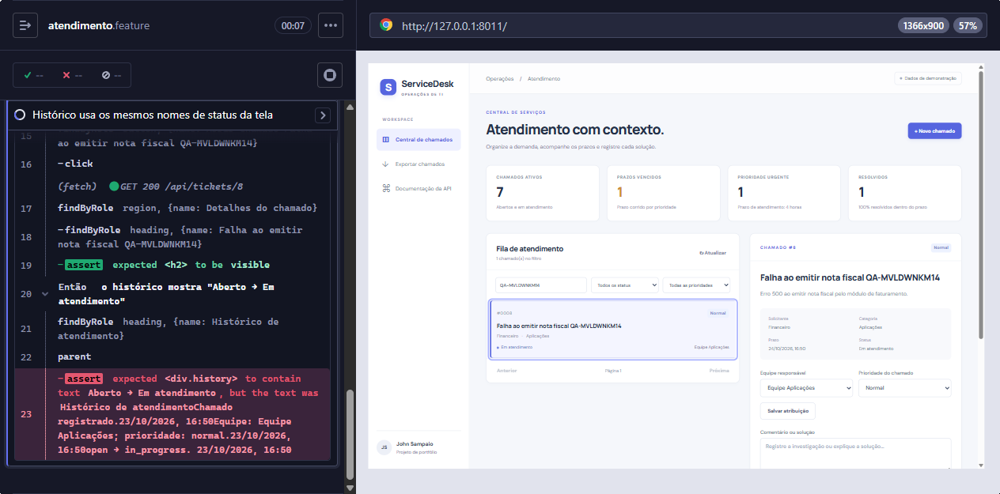
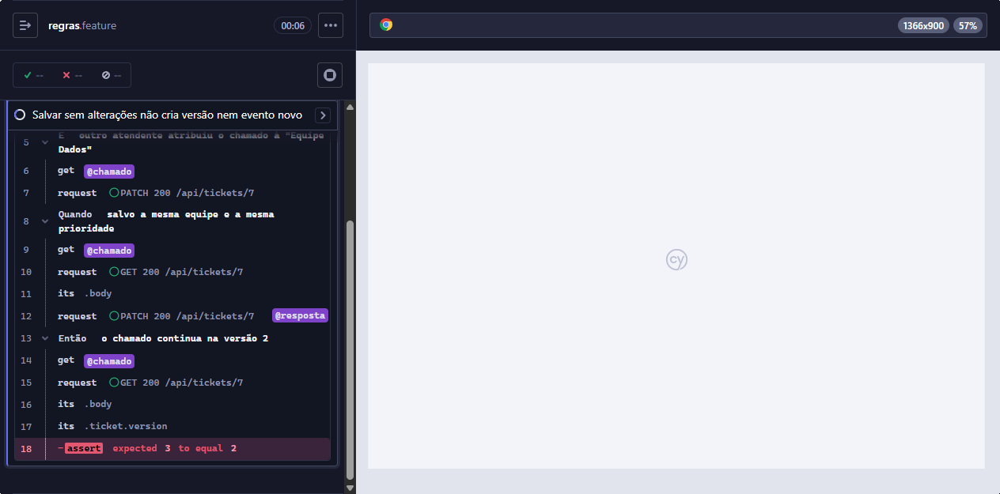
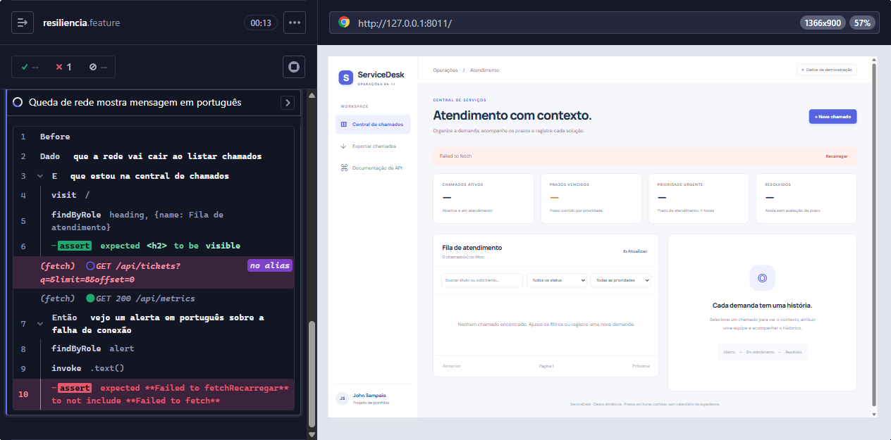

# Defeitos encontrados

Defeitos encontrados no [ServiceDesk](https://github.com/JVCSampaio/service-desk) na versão
[`520888b`](https://github.com/JVCSampaio/service-desk/tree/520888b0b6e6150b43b35c27cd4a03503ec73733),
durante a sessão exploratória e a automação desta suíte. Ambiente: Windows 11, Chrome 155,
Python 3.14 e Node.js 24, com a aplicação compilada servida pela API.

Cada defeito tem um cenário `@bug` que descreve o comportamento **esperado** e, por isso, falha
enquanto o defeito existir. Esses cenários ficam fora do gate do CI (`not @bug`) e podem ser
executados com `npm run test:bugs`. Quando um defeito for corrigido, o cenário passa a passar e
a tag `@bug` é removida, transformando-o em teste de regressão.

| ID                | Defeito                                                                                  | Severidade | Prioridade | Cenário                  |
| ----------------- | ---------------------------------------------------------------------------------------- | ---------- | ---------- | ------------------------ |
| [BUG-01](#bug-01) | Busca acima de 120 caracteres mostra erro genérico e fila desatualizada                  | Baixa      | Baixa      | `ui/fila.feature`        |
| [BUG-02](#bug-02) | Alerta de erro continua na tela depois que a consulta seguinte dá certo                  | Média      | Média      | `ui/resiliencia.feature` |
| [BUG-03](#bug-03) | Título com espaços passa no formulário, é recusado pela API e o aviso não indica o campo | Baixa      | Baixa      | `ui/registro.feature`    |
| [BUG-04](#bug-04) | Histórico mostra códigos internos (`open → in_progress`, `prioridade: high`)             | Baixa      | Média      | `ui/atendimento.feature` |
| [BUG-05](#bug-05) | Salvar sem alterações cria versão e evento novos, provocando conflito falso              | Média      | Média      | `api/regras.feature`     |
| [BUG-06](#bug-06) | Falha de rede aparece como "Failed to fetch" e a fila diz que não há chamados            | Baixa      | Média      | `ui/resiliencia.feature` |

Critérios: **severidade** mede o impacto no uso (nenhum defeito bloqueia o fluxo principal);
**prioridade** sugere a ordem de correção considerando frequência e custo da correção.

---

## BUG-01

**Busca acima de 120 caracteres mostra erro genérico e fila desatualizada**

| Campo                   | Valor                                                           |
| ----------------------- | --------------------------------------------------------------- |
| Componente              | Interface: fila de atendimento                                  |
| Severidade / prioridade | Baixa / Baixa                                                   |
| Cenário automatizado    | [`fila.feature`](../cypress/e2e/ui/fila.feature), tag `@BUG-01` |

**Passos**

1. Abrir a central de chamados.
2. Colar no campo de busca um texto com 121 caracteres (por exemplo, uma mensagem de erro inteira).

**Esperado:** o campo limita a busca a 120 caracteres, como a API, ou informa o limite; a fila
mostra só resultados do termo buscado.

**Obtido:** alerta "Não foi possível concluir a operação. Verifique os campos e tente novamente."
A fila continua listando os chamados anteriores, que não correspondem ao termo exibido na busca.

**Causa provável:** a API aceita no máximo 120 caracteres em `q`
([`main.py:91`](https://github.com/JVCSampaio/service-desk/blob/520888b0b6e6150b43b35c27cd4a03503ec73733/app/main.py#L91))
e devolve 422 acima disso, mas o campo de busca não tem `maxLength`
([`App.tsx:329`](https://github.com/JVCSampaio/service-desk/blob/520888b0b6e6150b43b35c27cd4a03503ec73733/web/src/App.tsx#L329)).

**Sugestão:** `maxLength={120}` no campo de busca.

---

## BUG-02

**Alerta de erro continua na tela depois que a consulta seguinte dá certo**

| Campo                   | Valor                                                                         |
| ----------------------- | ----------------------------------------------------------------------------- |
| Componente              | Interface: tratamento de erros                                                |
| Severidade / prioridade | Média / Média                                                                 |
| Cenário automatizado    | [`resiliencia.feature`](../cypress/e2e/ui/resiliencia.feature), tag `@BUG-02` |

**Passos**

1. Abrir a central de chamados com a listagem falhando uma vez (simulado com `cy.intercept`
   respondendo 500; na prática, uma instabilidade passageira do servidor).
2. Mudar o filtro de status para "Aberto".

**Esperado:** com a nova consulta bem-sucedida, a fila é atualizada e o alerta de erro desaparece.

**Obtido:** a fila é atualizada, mas o alerta de erro continua visível até o usuário clicar em
"Recarregar". O mesmo acontece depois do BUG-01: apagar um caractere da busca refaz a consulta
com sucesso, e o alerta permanece. O atendente vê dados corretos ao lado de um aviso de falha.

**Causa provável:** o carregamento da fila chama `setError` na falha, mas não limpa o erro no
sucesso
([`App.tsx:75-83`](https://github.com/JVCSampaio/service-desk/blob/520888b0b6e6150b43b35c27cd4a03503ec73733/web/src/App.tsx#L75-L83)).

**Sugestão:** `setError('')` quando a listagem for concluída com sucesso.

---

## BUG-03

**Título com espaços passa no formulário, é recusado pela API e o aviso não indica o campo**

| Campo                   | Valor                                                                   |
| ----------------------- | ----------------------------------------------------------------------- |
| Componente              | Interface e API: registro de chamado                                    |
| Severidade / prioridade | Baixa / Baixa                                                           |
| Cenário automatizado    | [`registro.feature`](../cypress/e2e/ui/registro.feature), tag `@BUG-03` |

**Passos**

1. Clicar em "+ Novo chamado".
2. Preencher o título com `"    a"` (quatro espaços e uma letra), solicitante e descrição válidos.
3. Clicar em "Criar chamado".

**Esperado:** o formulário indica que o título precisa de pelo menos 5 caracteres, no navegador
ou com a mensagem da API apontando o campo.

**Obtido:** o navegador aceita o envio, porque `minLength` conta os espaços. A API remove os
espaços das pontas, recusa com 422, e a interface mostra a mensagem genérica "Verifique os
campos", sem dizer qual.

**Causa provável:** regras diferentes entre interface
([`App.tsx:261`](https://github.com/JVCSampaio/service-desk/blob/520888b0b6e6150b43b35c27cd4a03503ec73733/web/src/App.tsx#L261))
e API
([`main.py:22`](https://github.com/JVCSampaio/service-desk/blob/520888b0b6e6150b43b35c27cd4a03503ec73733/app/main.py#L22)),
e os detalhes do erro 422 são descartados
([`api.ts:10-12`](https://github.com/JVCSampaio/service-desk/blob/520888b0b6e6150b43b35c27cd4a03503ec73733/web/src/api.ts#L10-L12)).

**Sugestão:** validar o valor sem espaços nas pontas antes de enviar e traduzir o campo do 422
para a mensagem exibida.

---

## BUG-04

**Histórico mostra códigos internos em vez dos nomes da tela**

| Campo                   | Valor                                                                         |
| ----------------------- | ----------------------------------------------------------------------------- |
| Componente              | API (texto dos eventos) e interface (histórico)                               |
| Severidade / prioridade | Baixa / Média                                                                 |
| Cenário automatizado    | [`atendimento.feature`](../cypress/e2e/ui/atendimento.feature), tag `@BUG-04` |

**Passos**

1. Atribuir uma equipe a um chamado e iniciar o atendimento.
2. Abrir o histórico do chamado.

**Esperado:** o histórico usa os mesmos nomes da tela: "Aberto → Em atendimento", "prioridade: Alta".

**Obtido:** "open → in_progress." e "Equipe: Equipe Dados; prioridade: high.", enquanto o restante
da tela mostra "Em atendimento" e "Alta". O problema aparece em todo chamado atendido.

**Causa provável:** as notas dos eventos são montadas com os códigos dos enums
([`main.py:159`](https://github.com/JVCSampaio/service-desk/blob/520888b0b6e6150b43b35c27cd4a03503ec73733/app/main.py#L159)
e [`main.py:179`](https://github.com/JVCSampaio/service-desk/blob/520888b0b6e6150b43b35c27cd4a03503ec73733/app/main.py#L179)).

**Sugestão:** gravar os rótulos em português ou guardar os códigos em campos próprios do evento
e traduzi-los na interface.

---

## BUG-05

**Salvar sem alterações cria versão e evento novos, provocando conflito falso**

| Campo                   | Valor                                                                |
| ----------------------- | -------------------------------------------------------------------- |
| Componente              | API: `PATCH /api/tickets/{id}`                                       |
| Severidade / prioridade | Média / Média                                                        |
| Cenário automatizado    | [`regras.feature`](../cypress/e2e/api/regras.feature), tag `@BUG-05` |

**Passos**

1. Dois atendentes abrem o mesmo chamado (versão 2).
2. O atendente A clica em "Salvar atribuição" sem mudar nada.
3. O atendente B altera a prioridade e salva.

**Esperado:** salvar os mesmos valores não altera o chamado; B salva normalmente.

**Obtido:** o passo 2 incrementa a versão para 3 e grava no histórico um evento repetido
("Equipe: ...; prioridade: ..."). No passo 3, B recebe "Este chamado foi alterado. Recarregue
antes de salvar novamente.", embora nada tenha mudado.

**Causa provável:** a rota incrementa a versão e registra evento sem comparar os valores novos
com os atuais
([`main.py:140-159`](https://github.com/JVCSampaio/service-desk/blob/520888b0b6e6150b43b35c27cd4a03503ec73733/app/main.py#L140-L159)).

**Sugestão:** quando equipe e prioridade forem iguais às atuais, devolver o chamado sem gravar.
O comportamento esperado deve ser confirmado com o responsável pelo produto.

---

## BUG-06

**Falha de rede aparece como "Failed to fetch" e a fila diz que não há chamados**

| Campo                   | Valor                                                                         |
| ----------------------- | ----------------------------------------------------------------------------- |
| Componente              | Interface: tratamento de erros                                                |
| Severidade / prioridade | Baixa / Média                                                                 |
| Cenário automatizado    | [`resiliencia.feature`](../cypress/e2e/ui/resiliencia.feature), tag `@BUG-06` |

**Passos**

1. Abrir a central de chamados sem conexão com a API (simulado com `cy.intercept` e
   `forceNetworkError`).

**Esperado:** mensagem em português indicando falha de conexão e a opção de tentar de novo.

**Obtido:** o alerta mostra a mensagem técnica do navegador, em inglês: "Failed to fetch".
Ao mesmo tempo, a fila exibe "Nenhum chamado encontrado. Ajuste os filtros...", como se a busca
tivesse sido feita. Erros 500 também aparecem como "Verifique os campos", que não se aplica.

**Causa provável:** a função `api()` não trata a rejeição do `fetch` e usa a mesma mensagem para
qualquer erro sem `detail` em texto
([`api.ts:2-12`](https://github.com/JVCSampaio/service-desk/blob/520888b0b6e6150b43b35c27cd4a03503ec73733/web/src/api.ts#L2-L12)).

**Sugestão:** capturar a falha de rede com uma mensagem própria, diferenciar 5xx de 422 e não
exibir o estado vazio quando a listagem falhar.

